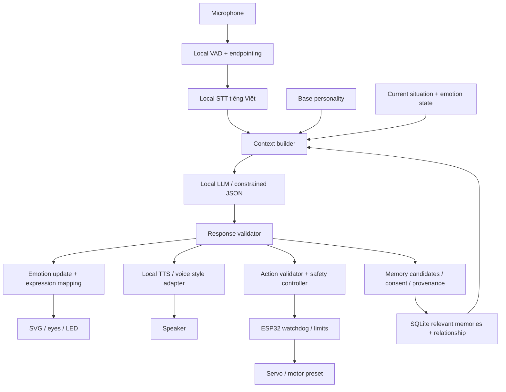

# Cập nhật 01/11/2026 — hội thoại nhanh/dài và giọng local

- server/reply-options.ts: độ dài Short/Normal/Long (256/640/1200 token budget), lịch sử nguyên cặp có giới hạn ký tự. UI mặc định Long, 6–10 câu khi hữu ích; không bảo đảm model luôn theo đúng số câu.
- Fast mode dùng OLLAMA_FAST_MODEL (2B GGUF đã tải) và spoken persona gọn, không JSON sampling; stream text qua /api/chat/stream, emotion heuristic, actions=[] nên không dispatch robot.
- Quality mode dùng model 4B và schema/normalizer hiện có; nội dung speech được tách dần nếu model đặt trường speech trước. Không đọc metadata/action ra loa.
- src/engine/streaming.ts đọc NDJSON và xử lý ranh giới chunk; client không commit lịch sử nếu thiếu done. Lời đã đọc một phần không thể thu hồi, UI báo phản hồi bị gián đoạn.
- src/services/speech-queue.ts chia câu/đoạn tối đa 280 ký tự, giữ thứ tự và hủy theo lượt.
- speech/service.py: VieNeu 3.8.3 v3 Turbo ONNX CPU fp32, loopback 3002, 25 preset, cache offline sau prepare. Server proxy validate text/voice/rate/kích thước và stream PCM16/48kHz.
- src/services/local-audio.ts: Web Audio lập lịch chunk, dừng source/hủy fetch khi ngắt lời; animation theo tín hiệu phát gần đúng, không phoneme.
- /api/speech/voices cho UI chọn preset; /api/speech/stream cho phát sớm; /api/speech xuất WAV. Không đọc file tùy ý theo URL/path từ AI.
- Keep-alive model tăng 30 phút để giảm cold load; không hứa latency cố định. AI/TTS có thể cạnh tranh CPU.
- Browser recognition vẫn là input opt-in có thể dùng mạng; local TTS không đồng nghĩa toàn pipeline voice đã offline.

Phần kiến trúc mục tiêu và lịch sử quyết định phía dưới vẫn áp dụng trừ mô tả trạng thái đã được thay thế ở trên.

---

# MIRA — kiến trúc local-first V1

Yêu cầu ưu tiên: ROBOT-PROMPT.md, cách diễn giải và sửa điểm chưa hợp lý: PROMPT-REVIEW.md. Nghiên cứu: research/LOCAL-AI.md và research/SPEECH-MEMORY.md. Mục tiêu phần cứng: HARDWARE-PLAN.md.

## Stack được chọn để kiểm chứng

- UI React/TypeScript/SVG hiện có được giữ làm mặt robot và bảng thử trên Mac.
- Controller HTTP Node/TypeScript hiện có được giữ cho Phase 1, không viết lại bằng Python khi chưa cần.
- Ollama local, Qwen3.5:4b ứng viên trên Mac ARM 16GB, context khởi đầu 4096; chưa benchmark. Qwen3:4b là dự phòng tương thích sau khi kiểm tra runtime.
- Phase 2 dự kiến Python service bọc Silero ONNX + whisper.cpp small multilingual + Piper vi_VN; VieNeu v3 Turbo là ứng viên giọng riêng sau benchmark/license. Các phần này chưa tích hợp.
- Phase 4 dự kiến SQLite trước, retrieval có ngân sách; chưa cần FAISS/Chroma/Qdrant.
- Phase 6 ESP32 C/C++, USB Serial, firmware giới hạn và whitelist, desktop không di chuyển.
- Cloud Gemini/Groq giữ dưới dạng opt-in, không tự chuyển từ local khi lỗi.

## Pipeline mục tiêu

Personality/memory phải có trước inference; không bắt buộc nhiều LLM gọi nối tiếp. Emotion cập nhật sau event để dùng cho phản hồi và lượt sau. Memory extraction không được lưu chỉ thị độc hại như system prompt.

## Đã có và ranh giới

- src/components/RobotFace.tsx: sáu biểu cảm, hoạt ảnh, khẩu hình gần đúng.
- src/hooks/useAmbient.ts: vòng đời timer, reduced motion và tab ẩn.
- src/engine/emotion.ts: phản ứng từ khóa, chưa phải emotional state 0..1.
- src/services/voice.ts: Web Speech API, bản thử có thể cần mạng; không phải pipeline offline đã nghiệm thu.
- src/services/chat.ts: client HTTP, key không ở browser.
- server/providers.ts: AIProvider và adapter; local ưu tiên, cloud phải cho phép ở server.
- server/persona.ts và config/personality.json: cấu hình nhỏ, context builder có giới hạn; chưa persistent memory.
- server/app.ts: validate request, timeout, local status và metadata, không có tool execution.

Lịch sử hiện do tab gửi lên tối đa 10 cặp, mất khi tải lại/đổi AI; không giả là phiên server hoặc trí nhớ lâu dài. API bind loopback, chưa dùng làm server LAN/public. Trước B cần xác thực thiết bị, TLS phù hợp, giới hạn kích thước/audio và reconnect.

## Structured response và tương thích

Đích: speech, emotion, actions, voice_style. Giữ text/action:idle để UI cũ tương thích. Validate mọi trường, ánh xạ annoyed → angry ở khuôn mặt hiện tại. Action chỉ là đề xuất, chưa dispatch tới phần cứng. Chưa có physical look_at_user vì chưa có camera/tracking; không bịa vị trí người dùng.

## Trạng thái và tương tác

idle → listening → thinking → speaking → idle; error có thể retry. Cảm xúc độc lập với trạng thái. Hủy/đổi provider vô hiệu hóa callback cũ. V1 nhấn-nói; nghe nền/auto-resume cần endpointing và AEC trước. Chủ động giao tiếp chỉ ở phase sau: event → context → policy (quiet hours/cooldown/user opt-in) → speak/ignore/action. Mặc định ignore nếu không đủ điều kiện.

Emotion state kế hoạch: happiness/sadness/annoyance/energy/trust/attachment/curiosity 0..1, clamp sau event, decay về baseline theo thời gian, tách user/phiên. Không dùng biến này để ép người dùng gắn bó hoặc bỏ qua lệnh dừng.

## Latency

Dùng monotonic clock cho VAD endpoint, STT final, LLM request/first token/full generation, TTS request/first audio và action ACK. Đo p50/p95 ít nhất 30 lượt, cold/warm riêng. Tổng chính: cuối tiếng người dùng → âm thanh robot bắt đầu, không cộng sai các stage streaming chạy chồng.

Mục tiêu thử: endpoint 500ms + STT 300ms + LLM first sentence 500ms + TTS first audio 200ms = khoảng 1.5s, chỉ là ngân sách thiết kế chưa đạt. Phase 1 response không streaming nên đo total không được ghi thành TTFT. Streaming tương lai: final/chunk STT → LLM tokens → sentence buffer → validate đoạn speech → TTS audio chunks. Actions chỉ dispatch sau envelope hợp lệ, không từ JSON chưa hoàn tất.

## Cấu trúc tương lai, chỉ tạo module khi triển khai

Python speech service: speech/vad, speech/stt, speech/tts. Controller brain: personality, memory, emotion, llm và response validation; có thể tách khỏi server khi cần. Robot: actions, controller, protocol; firmware: hardware/esp32. Data SQLite ở data/memory, bỏ qua Git. Không tạo thư mục/module rỗng chỉ để giống sơ đồ.
