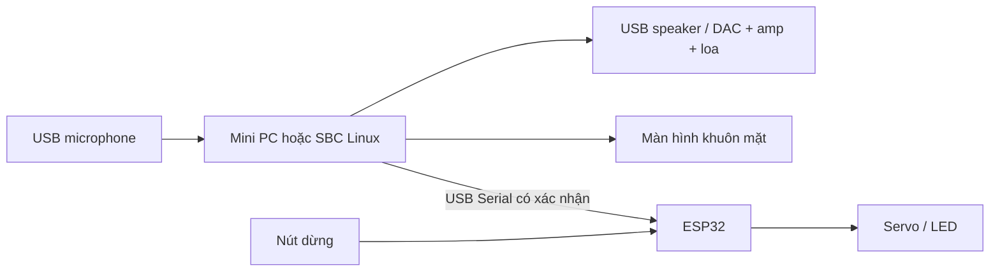
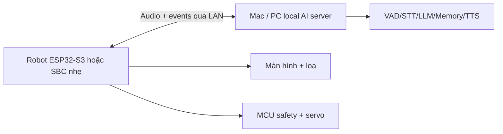

# Hai kiến trúc và BOM prototype ≤5 triệu

Ngày lập kế hoạch 31/10/2026. Giá là hạn mức dự toán để tìm hàng, không phải báo giá hoặc xác nhận tồn kho. Không mua hàng tự động. Đối chiếu giá bán có thể đọc được: [Orange Pi 5 8GB](https://orangepi.vn/shop/orange-pi-5-chip-rk3588s-ram-8gb) đang hiển thị 5.500.000đ riêng board; [Pi 5 8GB](https://raspberrypi2nd.store/danh-muc-san-pham/raspberry-pi/raspberry-pi-5/) hiển thị khoảng 4.800.000–5.200.000đ. Vì vậy không mặc định hai board mới này đáp ứng tổng ngân sách. Một trang N100 có giá hiển thị bất hợp lý nên không dùng làm căn cứ dự toán.

## A — AI nằm trong robot để bàn

SBC chạy VAD/STT/LLM/personality/memory/emotion/TTS. ESP32 xử lý giới hạn và watchdog. Phiên bản đầu dùng nguồn bàn, chưa pin/di chuyển. Mini PC cũ x86 RAM 16GB + SSD là ứng viên mua; CPU thực tế cần benchmark. N100 là ứng viên so sánh, không bắt buộc và chưa xác nhận mua được trong hạn mức.

| Component / model tham chiếu | Mục đích | Dự toán VNĐ | Bắt buộc? |
| --- | --- | ---: | --- |
| Mini PC cũ, RAM 16GB, SSD ≥128GB, kèm adapter | AI + memory + controller | 2.800.000 | Có; chỉ mua nếu cấu hình/giá thực tế đạt |
| USB microphone mono, có hỗ trợ Linux | Thu tiếng, chưa cần array | 200.000 | Có |
| USB powered speaker có DAC tích hợp | Phát tiếng; không mua amp rời ở cấu hình này | 150.000 | Có |
| Màn HDMI khoảng 3.5–5 inch, tương thích Linux | Mặt robot | 650.000 | Có cho robot; tận dụng màn hiện có khi phát triển |
| ESP32 dev board | Bộ điều khiển cơ cấu | 180.000 | Có cho phase servo |
| 2 servo nhỏ SG90/MG90S phù hợp cơ khí | Quay đầu/biểu cảm | 120.000 | Có cho phase servo; xác minh tải |
| Nguồn servo riêng có bảo vệ, dây/cầu chì/nút dừng | Cấp nguồn và dừng | 250.000 | Có khi dùng servo |
| Khung/vỏ, dây USB, gá lắp | Lắp prototype | 250.000 | Có |
| Dự phòng linh kiện/vận chuyển | Chênh lệch giá | 300.000 | Có |
| **Tổng dự toán A** | | **4.900.000** | |

Đây là cấu hình có điều kiện: nếu mini PC không mua được ≤2.8 triệu hoặc màn/nguồn vượt dự toán, chưa thể cam kết A ≤5 triệu. Khi đó dùng máy có sẵn để nghiệm thu phần mềm rồi tìm báo giá khác, không tự hạ RAM hoặc bỏ phần bảo vệ để ép tổng. CPU 16GB không bảo đảm TTS cảm xúc/LLM 4B đạt phản hồi <2s.

## B — AI server local + robot client

Không cần Internet sau khi tải model, nhưng cần LAN và server bật. Đây là bước phát triển/thu nhỏ có đánh đổi; không đáp ứng mục tiêu cuối độc lập khỏi PC. ESP32 cần firmware audio streaming và renderer riêng; không chạy nguyên giao diện React trên ESP32.

| Component / model tham chiếu | Mục đích | Dự toán VNĐ | Bắt buộc? |
| --- | --- | ---: | --- |
| Mac hiện có | AI server, không tính chi phí mua mới | 0 | Có; chi phí điện vẫn có |
| ESP32-S3 N16R8 | Wi-Fi/audio client | 250.000 | Có |
| INMP441 I2S | Micro | 80.000 | Có |
| MAX98357A + loa nhỏ | DAC/amp + phát tiếng | 100.000 | Có |
| TFT SPI khoảng 1.9–2.4 inch | Mặt robot dạng firmware | 200.000 | Có |
| 2 servo nhỏ | Cử động | 120.000 | Có ở phase servo |
| Nguồn, bảo vệ, nút dừng, dây | Điện và dừng | 250.000 | Có |
| Vỏ/gá lắp | Cơ khí | 200.000 | Có |
| Dự phòng | Vận chuyển/chênh giá | 200.000 | Có |
| **Tổng B dùng Mac sẵn có** | | **1.400.000** | |
| Server cũ nếu cần mua riêng | Hạn mức tìm mua, chưa báo giá | 2.800.000 | Tùy chọn |
| **B gồm server theo hạn mức** | | **4.200.000** | |

Camera, distance sensor, IMU, motor driver, bánh xe và pin chưa tính trong BOM để bàn. Chỉ thêm ở phase tương ứng và tính lại tổng, nguồn khởi động motor, BMS, sạc và nhiệt. Không cấp servo qua chân nguồn yếu của SBC/MCU.

## So sánh

| Tiêu chí | A: AI trong robot | B: server + client |
| --- | --- | --- |
| Độc lập khỏi PC | Có khi lắp đủ | Không |
| Mạng | Không cần sau tải model | LAN bắt buộc; không cần WAN nếu tất cả local |
| Giá ban đầu | Có thể sát trần 5 triệu | Thấp nếu tận dụng PC |
| Độ trễ | Không có hop mạng, compute hạn chế | Thêm mạng, server mạnh có thể bù; phải đo |
| Pin/nhiệt/kích thước | Khó hơn, chưa hợp robot nắm tay | Client nhỏ, nhẹ và ít tải tính toán hơn |
| Nâng cấp | Bị giới hạn RAM/tản nhiệt robot | Dễ đổi model/server |
| Độ phức tạp | Đóng gói Linux/audio/nguồn | Thêm protocol, reconnect và firmware audio |

**Quyết định:** phát triển/benchmark trên Mac hiện có, dùng B để kiểm chứng tương tác nếu cần; mục tiêu nghiệm thu robot để bàn là A khi phần cứng/budget cho phép. Giai đoạn thu nhỏ đánh giá lại local 0.8–2B và chất lượng, hoặc chấp nhận server LAN; không gọi B là robot offline độc lập.

## Protocol và safety dự kiến, chưa kết nối thật

USB Serial đầu tiên; UART khi đóng gói. Wi-Fi/WebSocket/MQTT chỉ sau khi có nhu cầu và xác thực/giới hạn kết nối.

Envelope: version, command_id, type, expires_at/TTL; MCU trả ACK/NACK cùng ID và trạng thái. Whitelist desktop: LOOK_LEFT, LOOK_RIGHT, LOOK_UP, LOOK_DOWN, BLINK, HAPPY_ANIMATION, SAD_ANIMATION, STOP. Tham số chỉ cho phép count nhỏ hoặc preset, không PWM/voltage/góc tùy ý từ AI. MOVE_FORWARD_SHORT chưa bật ở bản để bàn.

Giới hạn cơ khí, tốc độ, cấp nguồn, TTL, deduplicate command ID và watchdog nằm ở MCU. STOP ưu tiên cao, trạng thái E-stop latched chỉ reset bằng thao tác người dùng phù hợp, không để LLM tự bỏ khóa. Mất heartbeat phải dừng an toàn. Thử mất mạng, kẹt servo, lệnh trùng, sai version và quá hạn trước khi nối AI. Vị trí dừng an toàn phải xác định theo cơ cấu thực tế, không mặc định mọi servo đều về 0 độ.
