# Workflow MIRA local-first

Đọc `robot.md`, `PROMPT-REVIEW.md`, `ROADMAP.md` và `workflow/STATE.md`. Prompt đầy đủ ở `ROBOT-PROMPT.md`. Bộ workflow cũ 00–09 được giữ làm tài liệu kỹ thuật tham khảo, không còn là thứ tự điều phối chính.

```mermaid
flowchart LR
  PC[1 Local Brain trên Mac/PC] --> Voice[2 Local Voice]
  Voice --> Persona[3 Personality]
  Persona --> Memory[4 Memory]
  Memory --> Emotion[5 Emotion state]
  Emotion --> Desk[6 Robot để bàn]
  Desk --> Sensors[7 Camera/sensors]
  Sensors --> Move[8 Di chuyển]
  Move --> Small[9 Thu nhỏ]
  Small --> Tune[10 Fine-tune nếu cần]
```



## Cách chạy trong chat

```text
Đọc workflow/MASTER.md và chạy phase hiện tại theo workflow/STATE.md.
```

Mỗi bước: mục tiêu → kiến trúc → cài đặt → mã → chạy thử → kết quả mong đợi → debug → ghi xác nhận bằng chứng. Không đưa hàng nghìn dòng code hoặc tự nhảy phase khi bước hiện tại chưa chạy thật.

Dừng:

```text
Dừng ở điểm an toàn và lưu checkpoint vào workflow/STATE.md.
```

Tiếp tục:

```text
Đọc workflow/MASTER.md và workflow/STATE.md; đối chiếu file thực tế rồi tiếp tục thao tác còn thiếu.
```

## Điểm bắt đầu hiện tại

Code UI/voice trình duyệt đã có, nhưng chưa có Ollama/model local được nghiệm thu. Đọc `workflow/PHASE-01-LOCAL-BRAIN.md`. Hoàn thành text → local LLM → structured response trước; giữ UI voice nhưng chưa gọi nó là pipeline offline.

Không cần mua hardware ở Phase 1–5. Xác minh BOM và benchmark trước Phase 6. Bản A tự chứa AI là mục tiêu robot để bàn; bản B LAN/server là lựa chọn trung gian với giới hạn độc lập được ghi rõ.

## Sửa sau phản hồi nghe giật và nội dung khó hiểu — 01/11/2026

Bản cũ đệm riêng từng câu rồi phát xong mới yêu cầu câu kế tiếp, nên CPU sinh giọng chậm tạo khoảng im lặng dài. Bản hiện tại đợi hoàn tất văn bản, tạo audio cho toàn bộ đoạn (chia request tối đa 500 ký tự), kiểm tra mọi đoạn hoàn tất rồi mới lập lịch phát nối tiếp. Không synthesize trong lúc đang phát. Đánh đổi: thời gian chờ trước khi nói dài hơn; không tuyên bố đã tăng tốc model hoặc đạt realtime. Không tự cắt ngắn câu trả lời dài người dùng đã chọn.

Prompt đã sửa: đệ chỉ AI, đại ca chỉ người dùng; tiếng Việt hiện đại, lời chào một lần, giảm cổ văn/ẩn dụ và không đùa khi an ủi. Không chỉ đổi lời mở đầu rồi coi nội dung đã đúng. Chưa có bằng chứng nghe loa tự nhiên/rõ tiếng; phải thử trên thiết bị thực tế.

Tiêu chí nghiệm thu mới: (1) hiện toàn bộ text trước khi nói, (2) không phát khi bất kỳ request TTS nào chưa hoàn tất, (3) audio giữa các đoạn được lập lịch liên tiếp, (4) Hủy dừng cả tải và phát, (5) model thật không lẫn đại ca/đệ và trả lời đúng trọng tâm. Đo riêng thời gian AI, tổng tạo audio và lúc loa bắt đầu; không lấy audio chunk đầu HTTP làm độ trễ nghe. Test ít nhất câu buồn, câu chào, câu hỏi kiến thức và đoạn hơn 500 ký tự. Khi chưa đạt ghi rõ, không đánh dấu phase hoàn tất.

## Giữ vai trước khi xuất câu trả lời — 01/11/2026

Lỗi thực tế: “Bẩm đại ca, sao cậu vẫn còn thức khuya vậy?” cho thấy chỉ prompt không đủ. Hiện server/role-check.ts kiểm tra lời mở đầu, lời chào lặp, các đại từ sai và một số mẫu gọi người dùng là đệ. server/providers.ts áp dụng cho cả Nhanh/Chất lượng và provider cloud nếu được bật. Không xuất text nháp trước kiểm tra; chỉ gửi nội dung đã đạt kiểm tra để UI hiển thị và TTS đọc. Không thay thế đại từ hàng loạt vì có thể làm sai trích dẫn/kiến thức.

Nếu lỗi: yêu cầu model viết lại đúng vai tối đa một lần, giữ câu hỏi gốc, cùng signal hủy/timeout. Nếu vẫn lỗi: báo lỗi rõ ràng, không đọc sai vai, không dùng câu mẫu để giả đáp án. Retry có thể làm chờ lâu hơn. Khi lịch sử assistant chứa lỗi vai theo bộ kiểm tra, chỉ giữ câu hỏi mới nhất trong ngữ cảnh gửi model để tránh học lại cách xưng hô sai; transcript trên UI vẫn còn. Đây là đánh đổi mất ngữ cảnh lượt đó, không xóa tin nhắn người dùng. Temperature Ollama giảm từ 0.7 xuống 0.3.

Các trích dẫn có dấu ngoặc kép, code và một số danh từ như bạn bè/cậu bé được giữ nguyên. Bộ kiểm tra theo mẫu chưa phải bộ phân tích ngữ nghĩa: có thể bỏ sót hoặc chặn nhầm câu phức tạp, đặc biệt nói về người thứ ba. Khi gặp lỗi, thêm ví dụ regression trước khi mở rộng quy tắc; không tuyên bố giữ vai tuyệt đối. Ví dụ nghiệm thu gồm người dùng tự xưng anh/tôi/mình, gọi AI là em/bạn; AI vẫn xưng đệ và gọi đại ca. Demo và lời chào đã đổi cùng nhân vật.
